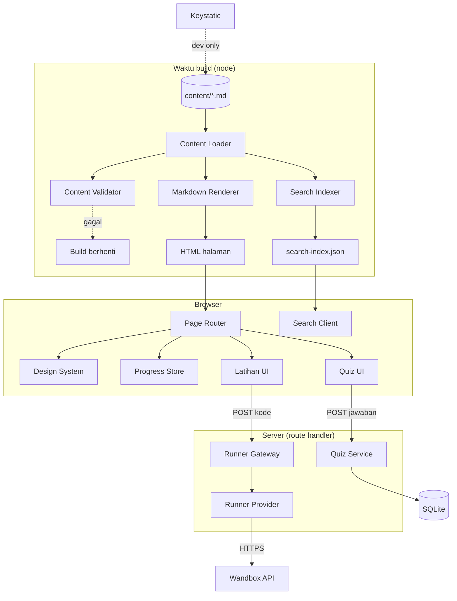

# 04 — BSD (Basic System Design)

## Pintas

Desain tingkat sistem: modul perangkat lunak, tanggung jawab masing-masing, dan alur data antar modul.
Detail teknis stack ada di `05-arsitektur.md`; bentuk data ada di `06-erd.md`.

Versi 1.0 — 2026-11-05

---

## 1. Prinsip desain

| # | Prinsip | Konsekuensi |
|---|---|---|
| P1 | **Konten bukan data aplikasi.** Materi adalah file Markdown di repo; DB hanya menyimpan hal yang harus dirahasiakan (kunci kuis, solusi). | Menambah modul tidak menyentuh kode maupun DB. |
| P2 | **Rahasia tinggal di server.** Apa pun yang tidak boleh dilihat pengguna tidak pernah ikut ke HTML/JS. | Kunci jawaban dan solusi hanya lewat API. |
| P3 | **Build gagal lebih baik daripada halaman rusak.** Validasi konten dijalankan di build. | Tidak ada modul setengah jadi yang lolos. |
| P4 | **Satu modul pelaksana untuk sandbox.** Semua panggilan ke layanan eksekusi kode lewat satu modul. | Ganti penyedia = ubah satu file. |
| P5 | **Tanpa state di server.** Tidak ada session, tidak ada cache pengguna. | Server bisa di-restart kapan saja tanpa kehilangan apa pun. |
| P6 | **Grafik sederhana.** Tema, pencarian, editor, progres — semuanya di klien, tanpa state global. | Lebih sedikit kode, lebih sedikit bug. |

## 2. Modul perangkat lunak

| # | Modul | Tanggung jawab | Tidak boleh melakukan |
|---|---|---|---|
| M1 | **Content Loader** | Membaca file di `content/`, memvalidasi frontmatter, menghasilkan objek modul bertipe | Merender HTML; menyentuh DB |
| M2 | **Markdown Renderer** | Mengubah Markdown → HTML tersanitasi, memisahkan lapis 1 / lapis 2, menambah `id` heading, mengubah blok kode jadi komponen | Mengambil data dari jaringan |
| M3 | **Content Validator** | Cek schema, slug unik, tautan internal, kelengkapan lapis 2 / kuis / latihan; dipakai di build dan CI | Mengubah file |
| M4 | **Search Indexer** | Membangun indeks pencarian (judul, heading, teks, kode) saat build | Mencari saat runtime di server |
| M5 | **Search Client** | Memuat indeks, mencocokkan kueri, menyorot hasil, mengelola riwayat dan keyboard | Memanggil server per ketikan |
| M6 | **Quiz Service** (server) | Mengambil soal tanpa kunci, menilai jawaban, mengembalikan hasil + penjelasan | Mengirim kunci di payload soal |
| M7 | **Runner Gateway** (server) | Memvalidasi permintaan latihan, meneruskan ke penyedia eksekusi, menormalkan hasil, rate limit | Menyimpan kode pengguna |
| M8 | **Runner Provider** | Adaptor penyedia eksekusi (Wandbox; kelak Piston lokal) | Mengandung aturan bisnis |
| M9 | **Progress Store** (klien) | Baca/tulis localStorage berversi, ekspor/impor, reset | Mengirim data ke server |
| M10 | **Page Router** | Rute Next.js, data fetching saat build, metadata per halaman | Mengandung logika bisnis |
| M11 | **Design System** | Token warna/spasi/tipe, komponen dasar (tombol, badge, `<details>`, blok kode, kartu) | Mengambil data |
| M12 | **Keystatic Admin** | UI edit konten, hanya di dev | Ada di build produksi |
| M13 | **DB Layer** (Prisma) | Akses SQLite, migrasi, seed soal & solusi | Berisi logika penyajian |

## 3. Diagram komponen



## 4. Alur data

### 4.1 Build (sekali per perubahan konten)
```
content/**.md
  → M1 baca + parse frontmatter
  → M3 validasi (schema, slug unik, tautan, kelengkapan)
     └ gagal → build berhenti, pesan menyebut file + field
  → M2 render HTML (pisah lapis 1 / lapis 2, sanitasi, id heading)
  → M4 bangun indeks pencarian
  → Next.js menulis halaman statis + search-index.json
```

### 4.2 Membuka modul
```
GET /modul/[track]/[slug]
  → halaman statis dari build (tanpa query DB)
  → browser: M9 baca status modul dari localStorage
  → Q memuat daftar soal (tanpa kunci) via GET /api/kuis/[slug]
```

### 4.3 Menjawab kuis
```
POST /api/kuis/[slug]/jawab  { soal_id, jawaban }
  → validasi bentuk input (NFR-07)
  → M6 ambil soal dari DB
  → bandingkan (normalisasi untuk isian singkat)
  → respons { benar, jawaban_benar, penjelasan }
  → klien simpan skor di localStorage
```

### 4.4 Menjalankan latihan web
```
POST /api/latihan/jalankan  { latihan_id, bahasa, kode }
  → M7 cek: bahasa di allowlist, ukuran ≤ 64 KB, rate limit per IP
  → M8 kirim ke Wandbox (timeout 15 s)
  → M7 normalkan stdout/stderr
  → bandingkan dengan output_harapan dari konten (bukan dari klien)
  → respons { status, stdout, stderr, exit_code, durasi_ms }
```

Catatan penting: `output_harapan` **tidak dikirim klien** — server membacanya dari file konten, jadi klien tidak bisa memalsukan kelulusan.

### 4.5 Mencari
```
Build: M4 → search-index.json (id, track, judul, heading[], teks, kode)
Klien: Ctrl+K → M5 muat indeks sekali → cocokkan di memori → render ≤ 8 hasil
```

## 5. Batas modul (interface)

| Antarmuka | Pemanggil → Penyedia | Bentuk |
|---|---|---|
| `getModules(track)` | M10 → M1 | `Module[]` |
| `renderModule(md)` | M1 → M2 | `{ lapis1: string, lapis2: string, toc: TocItem[] }` |
| `validateContent()` | build → M3 | `{ ok: boolean, errors: Error[] }` |
| `buildIndex(modules)` | build → M4 | `SearchDoc[]` |
| `search(index, query, filter)` | M5 internal | `SearchHit[]` |
| `gradeAnswer(soalId, jawaban)` | route → M6 | `{ benar, jawaban_benar, penjelasan }` |
| `runCode({ bahasa, kode, output_harapan })` | route → M7 | `RunResult` |
| `progress.get/set/export/import/reset` | UI → M9 | objek berversi `pintas:v1` |

## 6. Keputusan desain yang disengaja (dan alternatif yang ditolak)

| Keputusan | Alternatif | Alasan menolak alternatif |
|---|---|---|
| Konten di file Markdown | Konten di DB + panel admin | Dua sumber kebenaran, butuh CRUD yang dirawat, tidak ada manfaat untuk penulis tunggal |
| Tanpa login | Login + session | Progres lintas device bisa diselesaikan ekspor/impor JSON; login menambah permukaan serang |
| Penilaian kuis di server | Kunci di file konten | Kunci di file bisa dibaca lewat view-source dan repo publik |
| Satu adaptor sandbox | Panggil Wandbox langsung dari banyak tempat | Ganti penyedia jadi pekerjaan besar; juga membocorkan detail penyedia ke UI |
| Indeks pencarian saat build | Pencarian server-side (Meilisearch/Algolia) | Layanan tambahan, biaya, dan latensi; 500 modul masih ringan di klien |
| SQLite | PostgreSQL sejak awal | Satu berkas, nol setup; jalur pindah disiapkan lewat Prisma |

## 7. Yang sengaja tidak dibuat (dan kapan dibutuhkan)

| Tidak dibuat | Dibutuhkan saat |
|---|---|
| Login & akun | Ada lebih dari satu pengguna aktif yang butuh progres lintas device tanpa ekspor manual |
| Penilaian repo GitHub otomatis | Rubrik capstone sudah terbukti dipakai minimal 5 kali secara manual |
| Self-host sandbox | Wandbox membatasi atau lambat |
| Panel admin daring | Lebih dari satu penulis konten |
| Cache/ISR | Situs di-deploy publik dan konten berubah lebih dari sekali sehari |
| i18n | Ada permintaan pembaca bahasa Inggris |
