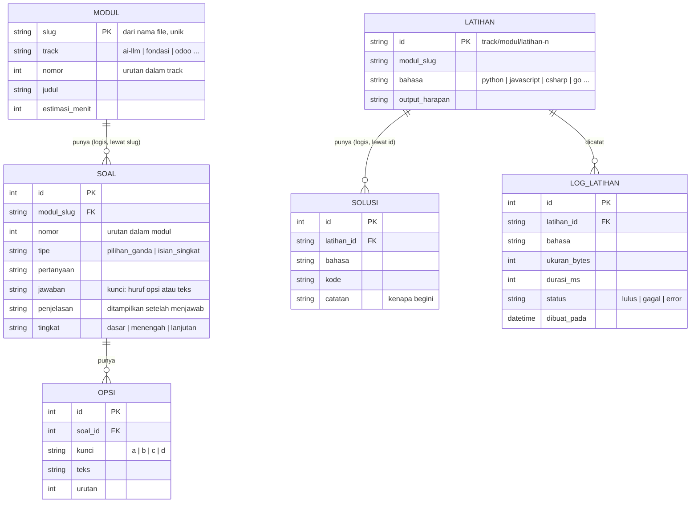

# 06 — ERD (Entity Relationship Diagram)

## Pintas

Model data. **Penting:** konten materi **tidak** ada di database — materi adalah file Markdown di `content/`.
DB hanya menyimpan hal yang harus dirahasiakan atau dicatat: soal kuis, kunci jawaban, solusi latihan, dan log eksekusi.

Versi 1.0 — 2026-11-05 · DB: SQLite (Prisma), siap pindah ke PostgreSQL

---

## 1. Entitas

| Entitas | Tabel | Fungsi | Sumber |
|---|---|---|---|
| `Soal` | `Soal` | Satu pertanyaan kuis milik satu modul | Diisi lewat seed dari frontmatter modul |
| `Opsi` | `Opsi` | Pilihan jawaban untuk soal `pilihan_ganda` | Sama |
| `Solusi` | `Solusi` | Kode solusi latihan web, diambil hanya saat diminta | Diisi lewat seed dari blok `solusi` di konten |
| `LogLatihan` | `LogLatihan` | Catatan eksekusi (tanpa isi kode pengguna) | Ditulis route handler |

Entitas yang **sengaja tidak ada**: `User`, `Session`, `Progress`, `Submission`, `Comment`, `Track`, `Modul`.
Alasan: tidak ada login, progres di localStorage, konten di file.

## 2. Diagram



Berkas terpisah untuk render mandiri: `06-erd.mmd`.

## 3. Detail atribut dan aturan

### 3.1 `Soal`
| Kolom | Tipe | Null | Aturan |
|---|---|---|---|
| `id` | INTEGER | tidak | PK autoincrement |
| `modul_slug` | TEXT | tidak | Harus cocok dengan slug modul di konten. Pola `^[a-z0-9-]+$` |
| `nomor` | INTEGER | tidak | 1..5, unik per `modul_slug` |
| `tipe` | TEXT | tidak | `pilihan_ganda` atau `isian_singkat` |
| `pertanyaan` | TEXT | tidak | Maks 1000 karakter |
| `jawaban` | TEXT | tidak | Untuk `pilihan_ganda`: kunci opsi (`a`..`d`). Untuk `isian_singkat`: teks jawaban |
| `penjelasan` | TEXT | tidak | Wajib — soal tanpa penjelasan ditolak saat seed |
| `tingkat` | TEXT | tidak | `dasar` / `menengah` / `lanjutan` |

Indeks: `UNIQUE(modul_slug, nomor)`.

**Aturan:** jumlah soal per `modul_slug` harus 3–5 (divalidasi saat seed). Menghapus modul dari konten **tidak** menghapus soal secara otomatis — seed menandai soal yatim dan gagal, supaya tidak ada sisa data diam-diam.

### 3.2 `Opsi`
| Kolom | Tipe | Null | Aturan |
|---|---|---|---|
| `id` | INTEGER | tidak | PK |
| `soal_id` | INTEGER | tidak | FK → `Soal.id`, `ON DELETE CASCADE` |
| `kunci` | TEXT | tidak | `a`, `b`, `c`, `d` — unik per `soal_id` |
| `teks` | TEXT | tidak | Maks 300 karakter |
| `urutan` | INTEGER | tidak | Urutan tampil |

Indeks: `UNIQUE(soal_id, kunci)`.

**Aturan:** soal `pilihan_ganda` wajib punya 3–4 opsi dan tepat satu opsi yang `kunci`-nya sama dengan `Soal.jawaban`. Soal `isian_singkat` tidak boleh punya opsi.

### 3.3 `Solusi`
| Kolom | Tipe | Null | Aturan |
|---|---|---|---|
| `id` | INTEGER | tidak | PK |
| `latihan_id` | TEXT | tidak | ID latihan di konten, pola `^[a-z0-9-/]+$` |
| `bahasa` | TEXT | tidak | Harus ada di allowlist runner |
| `kode` | TEXT | tidak | Maks 64 KB |
| `catatan` | TEXT | null | Kenapa solusinya begini |

Indeks: `UNIQUE(latihan_id, bahasa)`.

**Aturan:** solusi **tidak pernah** dikirim dalam payload halaman atau payload soal. Hanya lewat `GET /api/latihan/[id]/solusi` saat diminta.

### 3.4 `LogLatihan`
| Kolom | Tipe | Null | Aturan |
|---|---|---|---|
| `id` | INTEGER | tidak | PK |
| `latihan_id` | TEXT | tidak | FK logis ke `Solusi.latihan_id` (tidak dipaksa, karena latihan bisa tanpa solusi) |
| `bahasa` | TEXT | tidak | Dari allowlist |
| `ukuran_bytes` | INTEGER | tidak | Ukuran kode yang dikirim |
| `durasi_ms` | INTEGER | tidak | Durasi panggilan ke penyedia |
| `status` | TEXT | tidak | `lulus` / `gagal` / `error` |
| `dibuat_pada` | DATETIME | tidak | Default `now()` |

**Aturan keras (NFR-21):** **isi kode pengguna tidak disimpan.** Tidak ada kolom untuk itu, dan tidak boleh ditambahkan tanpa keputusan sadar (privasi).
Retensi: hapus baris lebih tua dari 30 hari saat start (satu query).

## 4. Relasi lintas batas (logis, bukan FK)

| Dari | Ke | Bagaimana dijaga |
|---|---|---|
| `Soal.modul_slug` | `content/**/<nomor>-<slug>.md` | Seed memeriksa file ada; build gagal bila soal menunjuk modul yang tidak ada |
| `Solusi.latihan_id` | `latihan[].id` di frontmatter | Seed memeriksa id latihan ada di modulnya |
| `Opsi` | `Soal` | FK nyata dengan cascade |

Karena konten bukan tabel, integritas dijaga oleh **seed + validator**, bukan oleh constraint DB. Ini konsekuensi yang diterima dari keputusan "konten di file" (lihat BSD § 6).

## 5. Skema Prisma (acuan implementasi)

```prisma
generator client { provider = "prisma-client-js" }
datasource db { provider = "sqlite"  url = env("DATABASE_URL") }
// pindah ke PostgreSQL: provider = "postgresql" — satu baris, tanpa ubah kode

model Soal {
  id          Int      @id @default(autoincrement())
  modulSlug   String
  nomor       Int
  tipe        String
  pertanyaan  String
  jawaban     String
  penjelasan  String
  tingkat     String   @default("dasar")
  opsi        Opsi[]
  @@unique([modulSlug, nomor])
  @@index([modulSlug])
}

model Opsi {
  id      Int    @id @default(autoincrement())
  soalId  Int
  kunci   String
  teks    String
  urutan  Int    @default(0)
  soal    Soal   @relation(fields: [soalId], references: [id], onDelete: Cascade)
  @@unique([soalId, kunci])
}

model Solusi {
  id        Int    @id @default(autoincrement())
  latihanId String
  bahasa    String
  kode      String
  catatan   String?
  @@unique([latihanId, bahasa])
}

model LogLatihan {
  id          Int      @id @default(autoincrement())
  latihanId   String
  bahasa      String
  ukuranBytes Int
  durasiMs    Int
  status      String
  dibuatPada  DateTime @default(now())
  @@index([dibuatPada])
}
```

## 6. Migrasi

| Versi | Isi |
|---|---|
| `0001_init` | Keempat tabel + indeks |
| `0002_…` | Ditambah saat dibutuhkan (mis. `User` bila login diaktifkan) |

Aturan: migrasi tidak boleh menghapus kolom berisi data tanpa migrasi data terpisah. Untuk MVP, seed ulang selalu aman karena isinya bisa dibangun ulang dari konten.
