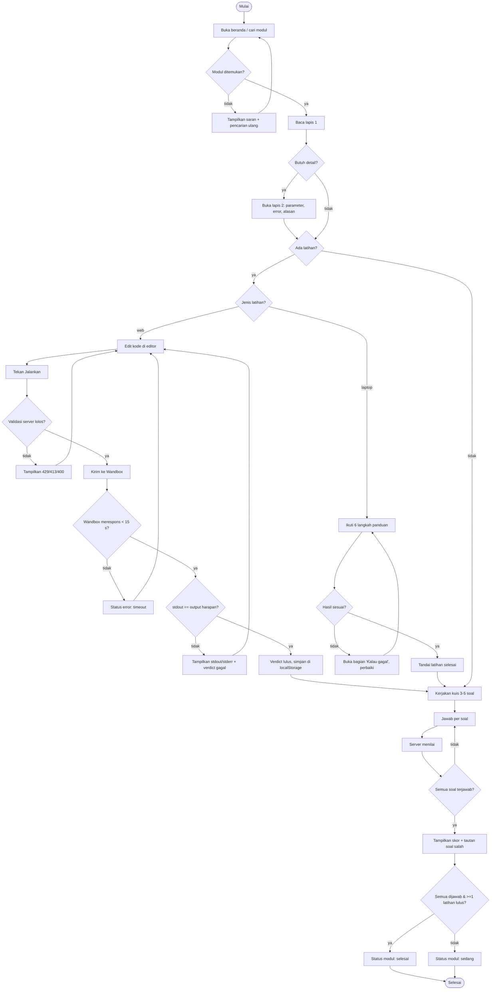
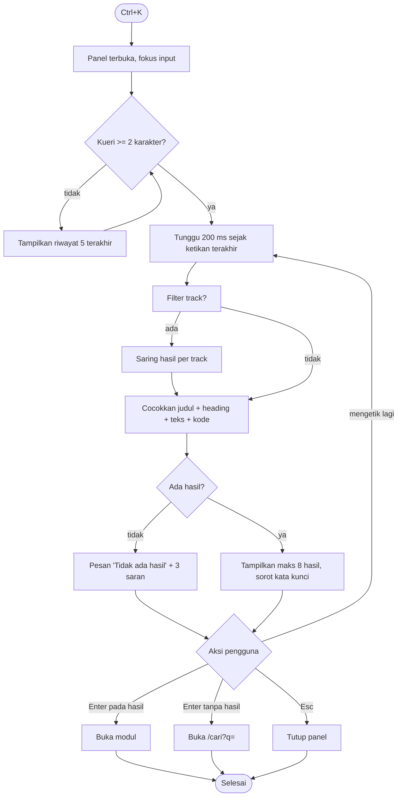
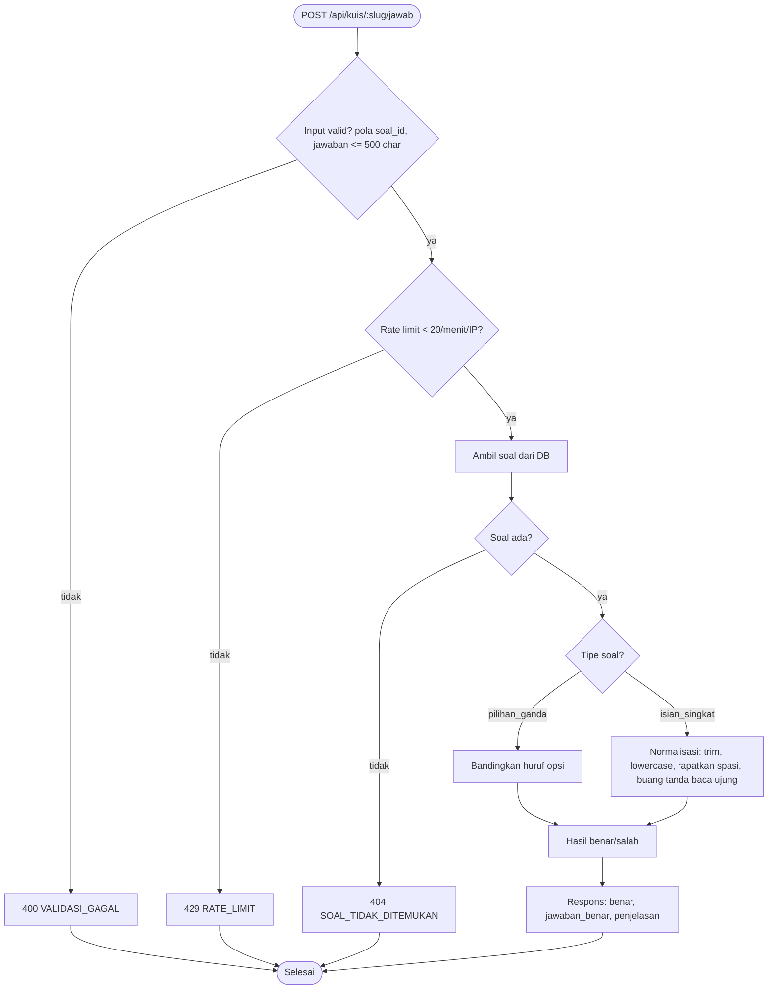
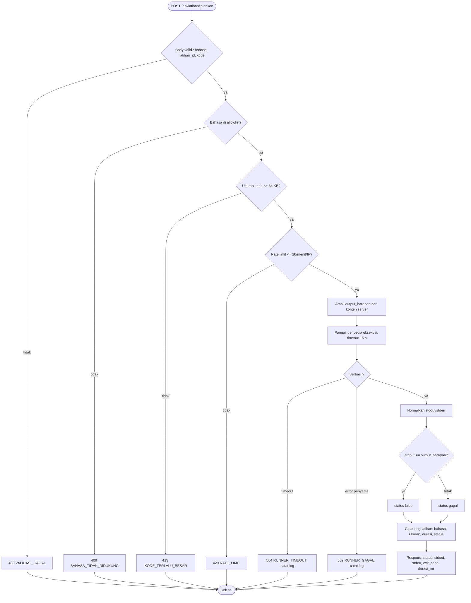
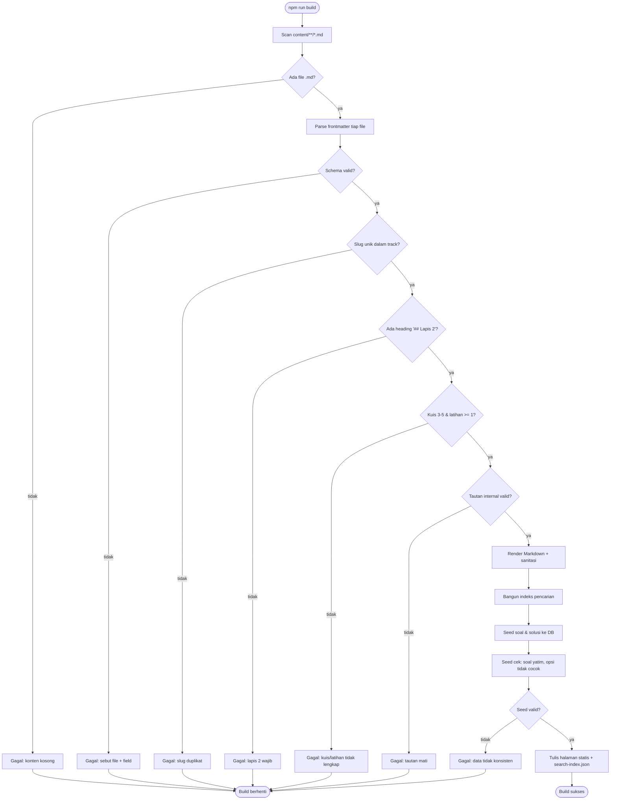
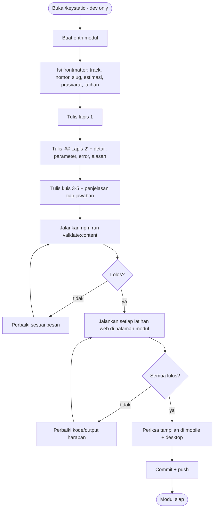
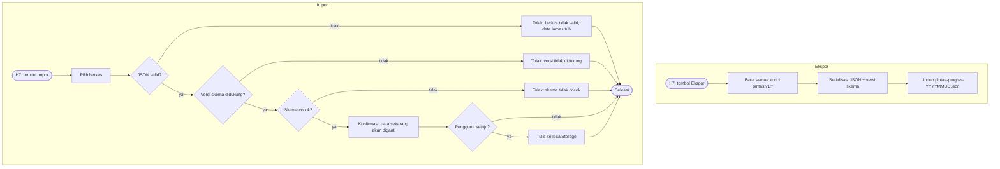

# 07 — UML: Activity

## Pintas

Alur aktivitas untuk proses yang punya percabangan penting. Versi 1.0 — 2026-11-05

---

## 1. Aktivitas: Mengerjakan satu modul (alur utama pengguna)

## 2. Aktivitas: Pencarian

## 3. Aktivitas: Penilaian kuis (server)

## 4. Aktivitas: Latihan web (server)

## 5. Aktivitas: Build dan validasi konten

## 6. Aktivitas: Menulis modul baru (penulis)

## 7. Aktivitas: Ekspor dan impor progres

