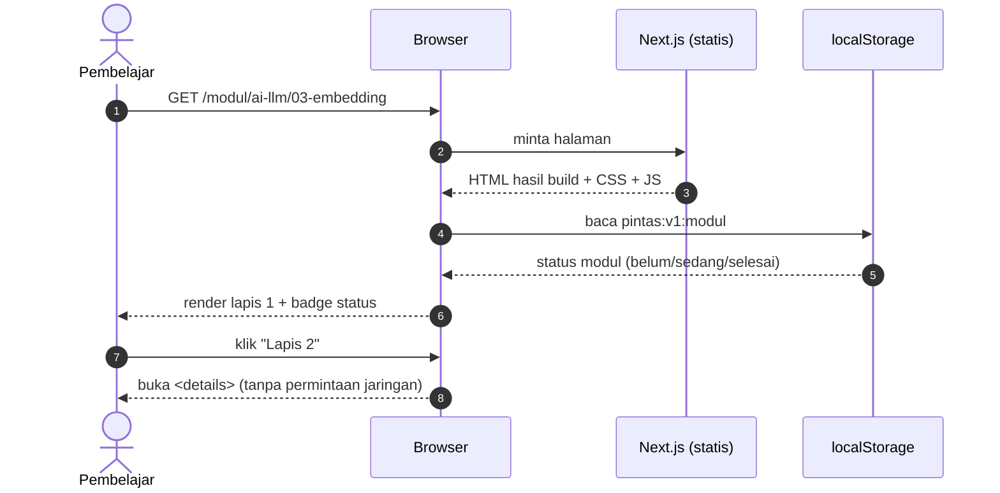
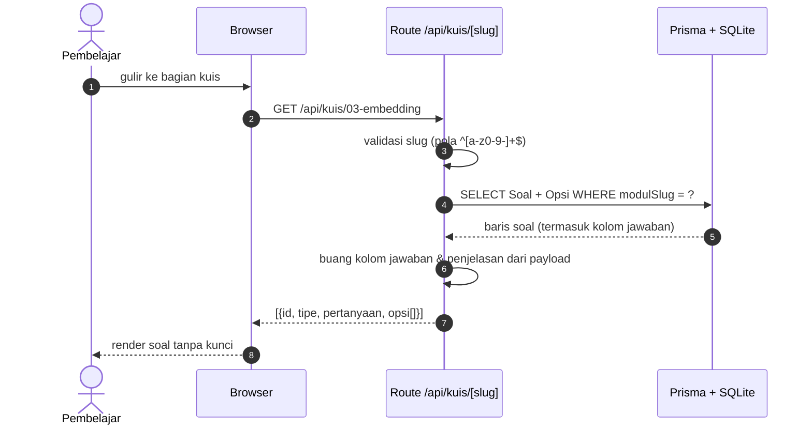
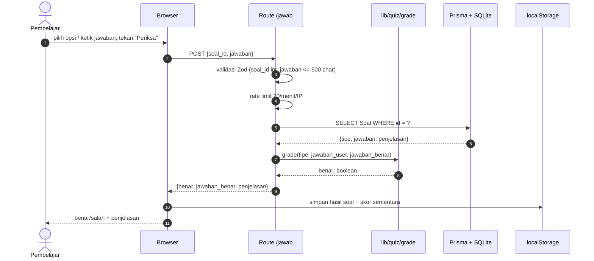
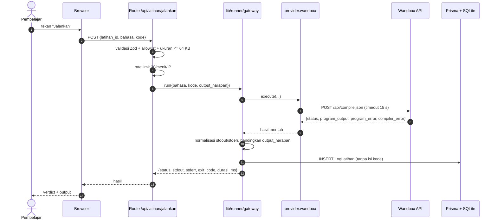
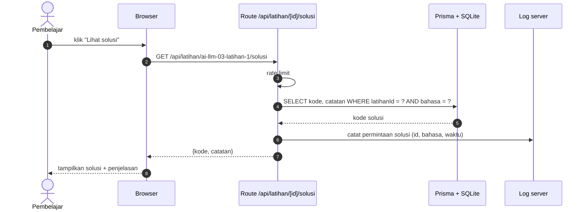
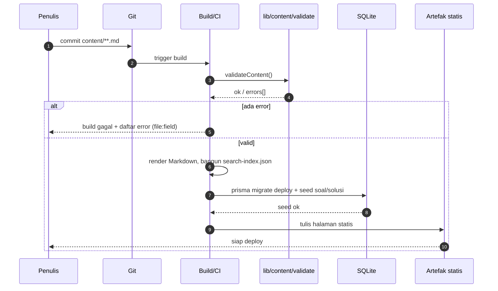
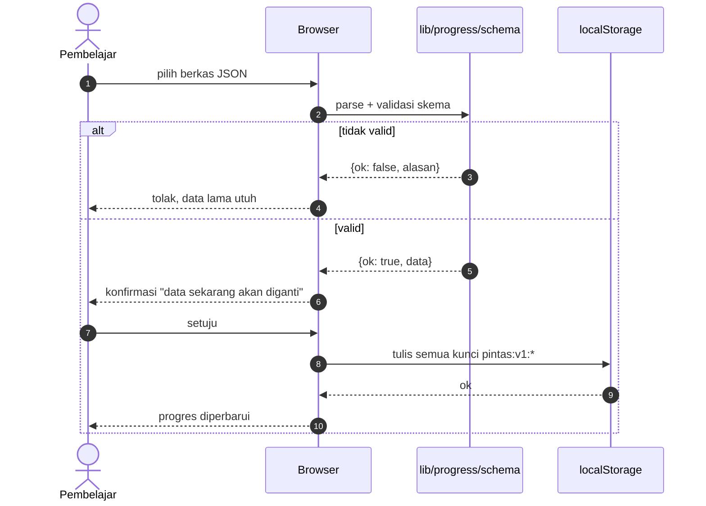

# 07 — UML: Sequence

## Pintas

Urutan pesan antar komponen untuk alur yang melibatkan server atau layanan luar.
Versi 1.0 — 2026-11-05

---

## 1. Membuka halaman modul (tanpa server)

Catatan: tidak ada query DB saat membuka modul. DB hanya dipakai untuk kuis dan solusi.

## 2. Mengambil soal kuis

## 3. Menjawab satu soal

## 4. Menjalankan latihan web

Alur gagal penting:
- Timeout → `GW` mengembalikan `status: error`, kode 504. Browser menampilkan pesan, bukan menggantung.
- Penyedia down → `status: error`, kode 502, pesan penyedia diteruskan apa adanya.

## 5. Melihat solusi latihan

Catatan: solusi sengaja tidak ada di payload halaman agar pembaca mencoba dulu. Ini bukan pengamanan keras — orang tetap bisa memintanya. Tujuannya mencegah godaan, bukan mencegah akses.

## 6. Build dan deploy

## 7. Impor progres

