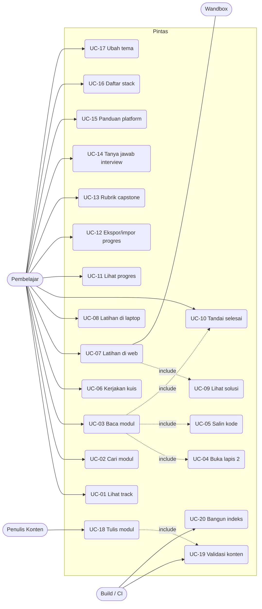

# 07 — UML: Use Case

## Pintas

Aktor, use case, dan skenario. Tanpa login: aktor hanya dua (Pembelajar, Penulis) plus sistem eksternal.

Versi 1.0 — 2026-11-05

---

## 1. Aktor

| Aktor | Jenis | Deskripsi |
|---|---|---|
| **Pembelajar** | primer (manusia) | Membaca modul, mengerjakan latihan dan kuis, mengerjakan capstone, menyimpan progres di browser |
| **Penulis Konten** | primer (manusia) | Menulis/mengubah modul lewat file Markdown + Keystatic di lokal |
| **Wandbox** | sekunder (sistem) | Menjalankan kode latihan web |
| **Build/CI** | sekunder (sistem) | Memvalidasi konten dan membangun indeks pencarian |

Catatan: **tidak ada aktor Admin daring.** Keystatic hanya jalan di mesin penulis.

## 2. Daftar use case

| ID | Use case | Aktor | Prioritas |
|---|---|---|---|
| UC-01 | Melihat daftar track | Pembelajar | wajib |
| UC-02 | Mencari modul | Pembelajar | wajib |
| UC-03 | Membaca modul (lapis 1) | Pembelajar | wajib |
| UC-04 | Membuka lapis 2 (detail) | Pembelajar | wajib |
| UC-05 | Menyalin kode contoh | Pembelajar | wajib |
| UC-06 | Mengerjakan kuis | Pembelajar | wajib |
| UC-07 | Mengerjakan latihan di web | Pembelajar, Wandbox | wajib |
| UC-08 | Mengerjakan latihan di laptop | Pembelajar | wajib |
| UC-09 | Melihat solusi latihan | Pembelajar | wajib |
| UC-10 | Menandai modul selesai | Pembelajar | wajib |
| UC-11 | Melihat progres | Pembelajar | wajib |
| UC-12 | Ekspor/impor progres | Pembelajar | wajib |
| UC-13 | Membaca rubrik capstone | Pembelajar | wajib |
| UC-14 | Berlatih tanya jawab interview | Pembelajar | wajib |
| UC-15 | Membaca panduan platform | Pembelajar | wajib |
| UC-16 | Melihat daftar stack | Pembelajar | wajib |
| UC-17 | Mengubah tema | Pembelajar | wajib |
| UC-18 | Menulis modul baru | Penulis | wajib |
| UC-19 | Memvalidasi konten | Penulis, Build/CI | wajib |
| UC-20 | Membangun indeks pencarian | Build/CI | wajib |

## 3. Diagram use case

## 4. Skenario rinci

### UC-02 — Mencari modul
| | |
|---|---|
| Aktor | Pembelajar |
| Prakondisi | Halaman apa pun terbuka |
| Pemicu | `Ctrl+K` atau klik kotak pencarian |

**Alur utama:**
1. Sistem membuka panel pencarian, fokus di input.
2. Pembelajar mengetik ≥ 2 karakter.
3. Sistem menunggu 200 ms sejak ketikan terakhir.
4. Sistem mencocokkan kueri ke indeks (judul, heading, teks, kode) dan menyaring sesuai filter track bila ada.
5. Sistem menampilkan maksimal 8 hasil, dikelompokkan per track, kata kunci disorot, potongan teks di sekitar kecocokan.
6. Pembelajar memilih hasil dengan `↑`/`↓` lalu `Enter`, atau klik.
7. Sistem membuka halaman modul pada posisi awal.

**Alur alternatif:**
- 2a. Kueri < 2 karakter → panel menampilkan riwayat 5 pencarian terakhir, bukan hasil.
- 5a. Tidak ada hasil → pesan "Tidak ada hasil untuk «kueri»" + 3 saran modul.
- 6a. `Enter` tanpa memilih → buka `/cari?q=` dengan hasil lengkap (20 per halaman).
- 6b. `Esc` → panel tertutup, fokus kembali ke elemen sebelumnya.

**Pascakondisi:** kueri tersimpan di riwayat (maks 5, bisa dihapus).

### UC-03 + UC-06 — Membaca modul lalu mengerjakan kuis
| | |
|---|---|
| Aktor | Pembelajar |
| Prakondisi | Modul ada dan terbuka |
| Pascakondisi | Skor tersimpan di localStorage; modul bisa berstatus selesai |

**Alur utama:**
1. Sistem menampilkan judul, estimasi, "Kamu akan bisa", prasyarat, lapis 1.
2. Pembelajar membaca lapis 1, menyalin/menjalankan kode.
3. Pembelajar membuka lapis 2 bila butuh detail.
4. Sistem menampilkan 3–5 soal (tanpa kunci jawaban).
5. Pembelajar menjawab soal satu per satu.
6. Server menilai tiap jawaban dan mengembalikan benar/salah + penjelasan.
7. Setelah semua terjawab, sistem menampilkan skor dan tautan ke bagian modul untuk soal yang salah.
8. Bila syarat terpenuhi (semua soal dijawab + ≥1 latihan lulus), modul berstatus selesai.

**Alur alternatif:**
- 6a. Jaringan gagal → jawaban ditandai "belum tersimpan", bisa dicoba ulang.
- 5a. Pembelajar menutup halaman di tengah → jawaban yang sudah dinilai tetap tersimpan di localStorage; soal yang belum dijawab tetap kosong saat kembali.

### UC-07 — Mengerjakan latihan di web
| | |
|---|---|
| Aktor | Pembelajar, Wandbox |
| Prakondisi | Latihan bertipe `web`; penyedia eksekusi tersedia |

**Alur utama:**
1. Sistem menampilkan soal latihan, output yang diharapkan, editor dengan kode awal, pilihan bahasa (bila lebih dari satu).
2. Pembelajar mengubah kode.
3. Pembelajar menekan "Jalankan".
4. Server memvalidasi: bahasa di allowlist, ukuran ≤ 64 KB, rate limit.
5. Server meneruskan ke Wandbox dengan timeout 15 detik.
6. Server menormalkan stdout/stderr dan membandingkan dengan `output_harapan`.
7. Sistem menampilkan stdout, stderr, status keluar, durasi, dan verdict `lulus`/`gagal`.
8. Sistem menyimpan kode terakhir + status di localStorage.

**Alur alternatif:**
- 4a. Melebihi rate limit → 429 + pesan "Tunggu sebentar".
- 5a. Timeout → status `error`, pesan "Eksekusi melebihi 15 detik".
- 5b. Penyedia mengembalikan error → status `error`, pesan penyedia ditampilkan apa adanya (tidak disamarkan).
- 3a. Tombol ditekan dua kali → permintaan kedua diabaikan.

### UC-08 — Mengerjakan latihan di laptop
| | |
|---|---|
| Aktor | Pembelajar |
| Prakondisi | Latihan bertipe `laptop` |

**Alur utama:**
1. Sistem menampilkan 6 bagian baku: Yang dibutuhkan · Langkah · Hasil yang harus muncul · Cek berhasil · Kalau gagal · Buktikan kamu paham.
2. Pembelajar menyalin perintah langkah demi langkah.
3. Pembelajar membandingkan hasil dengan yang tertulis.
4. Pembelajar menandai latihan selesai sendiri (self-report) — sistem tidak memverifikasi.

**Alur alternatif:**
- 3a. Hasil tidak sesuai → pembelajar membuka "Kalau gagal", mencocokkan error, mengikuti perbaikan.

### UC-10 — Menandai modul selesai
**Alur utama:** sistem menghitung syarat (semua soal dijawab + ≥1 latihan lulus) → bila terpenuhi, status `selesai` otomatis. Pembelajar dapat menandai manual kapan saja.
**Alternatif:** pembelajar membatalkan tanda selesai → status kembali `sedang`.

### UC-12 — Ekspor/impor progres
**Ekspor:** H7 → tombol "Ekspor" → berkas `pintas-progres-YYYYMMDD.json` terunduh, berisi `versi`, `modulSelesai`, `skorKuis`, `latihanLulus`, `interviewDikuasai`.
**Impor:** pilih berkas → validasi skema → bila valid, data lama **diganti** (bukan digabung) setelah konfirmasi; bila tidak valid, ditolak dan data lama utuh.

### UC-18 + UC-19 — Menulis dan memvalidasi modul
| | |
|---|---|
| Aktor | Penulis, Build/CI |
| Prakondisi | Repo lokal, `npm run dev` jalan |

**Alur utama:**
1. Penulis membuka `/keystatic` (hanya dev).
2. Membuat entri modul: track, nomor, judul, slug, estimasi, prasyarat, latihan, kuis.
3. Menulis lapis 1, heading `## Lapis 2`, lalu lapis 2.
4. Menyimpan → file `.md` tertulis di `content/`.
5. Penulis menjalankan `npm run validate:content`.
6. Validator memeriksa schema, slug unik, tautan internal, kelengkapan lapis 2/kuis/latihan, dan menjalankan latihan web yang bisa dijalankan.
7. Bila lolos, penulis membuka halaman modul dan memeriksa tampilan.
8. Commit.

**Alur alternatif:**
- 5a. Validasi gagal → pesan menyebut file + field; penulis memperbaiki, tidak bisa lanjut build.

## 5. Yang tidak ada di daftar use case (dan kenapa)

| Tidak ada | Alasan |
|---|---|
| Login / daftar / reset password | Tidak ada akun di MVP |
| Kirim project untuk dinilai | Penilaian otomatis = fase 2; MVP hanya rubrik |
| Komentar / diskusi | Tidak ada interaksi antarpengguna |
| Kelola pengguna (admin) | Tidak ada pengguna terdaftar |
| Unggah berkas | Konten lewat repo |
